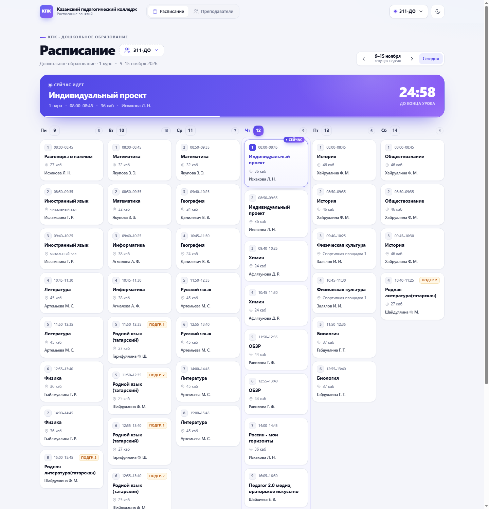
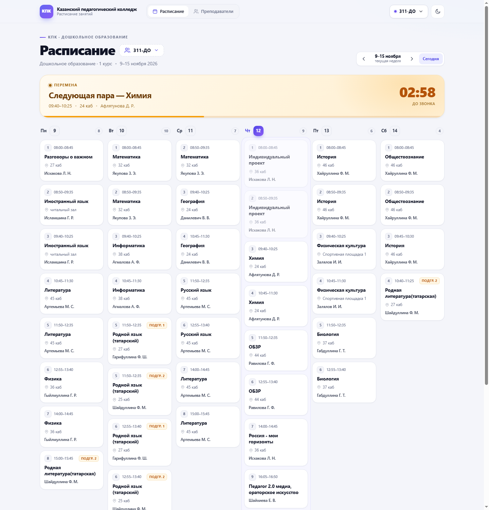

# Расписание занятий · Казанский педагогический колледж

Современный минималистичный сайт с расписанием пар по группам и преподавателям.
Данные берутся с официальных источников и обновляются автоматически.



## Что умеет

- **Выбор группы** — поиск по номеру, специальности или курсу, избранное и запоминание последней группы.
- **Недельное расписание** — пары по дням, кабинет, преподаватель, замены и подгруппы.
- **Режим «сейчас»** — текущая пара подсвечивается, а во время перемены показывается
  обратный отсчёт до звонка.
- **Преподаватели** — полные ФИО, должности, кафедры, стаж, квалификация, награды
  и фотографии (там, где они опубликованы).
- **Расписание преподавателя** — можно открыть неделю занятий конкретного педагога.
- **Светлая и тёмная тема**, адаптивность под телефон, планшет и десктоп.
- **Автообновление**: расписание — каждые 2 минуты, справочник преподавателей — каждые 6 часов,
  плюс кнопка «Обновить» для ручного обновления.



## Источники данных

| Что | Откуда |
| --- | --- |
| Расписание занятий | [site.mstimetables.ru](https://site.mstimetables.ru/01a058c16a6e7b1a8b8ae632e9e51329) — публичный JSON API |
| ФИО, должности, фото | [edu.tatar.ru/sovetcki/org6264](https://edu.tatar.ru/sovetcki/org6264) — карточки преподавателей |

Публикация расписания: `01a058c16a6e7b1a8b8ae632e9e51329`.

Скрапер сопоставляет преподавателей из расписания с карточками колледжа:
точное ФИО, инициалы, а при небольших расхождениях — нечёткое сравнение
(например, «Элфия» / «Эльфия», «Владмировна» / «Владимировна»).
Всего в справочнике **142 преподавателя**, из них **78** с карточками колледжа
и **33** с опубликованными фотографиями. Для остальных показываются инициалы.

Фотографии скачиваются на сервер: сайт edu.tatar.ru отдаёт их только с заголовком
`Referer`, поэтому браузер не может загрузить их напрямую.

## Запуск

Нужен **Node.js 18+**. Внешних зависимостей нет.

```bash
npm start
# или
node server.js
```

Сайт откроется на [http://127.0.0.1:4173](http://127.0.0.1:4173).

Порт и хост можно переопределить:

```bash
PORT=8080 HOST=0.0.0.0 node server.js
```

`HOST=0.0.0.0` нужен, если сайт должен быть доступен другим устройствам в сети.
Для публичного размещения поставьте сервер за reverse proxy (nginx/Caddy) и включите HTTPS.

### Первый запуск без данных

В комплекте уже лежат собранные `data/*.json` и фотографии. Если их удалить,
сервер при старте сам запустит первичный сбор. То же самое можно сделать вручную:

```bash
npm run refresh
# или
node lib/scrape.js
```

## Публикация в интернете

Сайт можно бесплатно выложить на **Render** и получить ссылку вида
`https://kpk-schedule.onrender.com`, которая будет работать без вашего компьютера.
Пошаговая инструкция — в [DEPLOY.md](DEPLOY.md).

Коротко: загрузите проект на GitHub, создайте на Render сервис из репозитория
(файл `render.yaml` уже описывает сборку и запуск), дождитесь деплоя и откройте
ссылку на телефоне.

В проекте также есть `Dockerfile` — он подойдёт для Koyeb, Fly.io и других
хостингов, умеющих Docker.

## Обновление информации

| Что | Как часто |
| --- | --- |
| Расписание (MSTimetable) | кэш 2 минуты; страница сама перезапрашивает раз в 2 минуты |
| Преподаватели и фото (edu.tatar.ru) | фоновое обновление каждые 6 часов |
| Кнопка «Обновить» | пересобирает справочник и заново запрашивает расписание (~3–4 секунды) |

Ручное обновление ограничено одним запуском в 30 секунд, чтобы не создавать
лишнюю нагрузку на сайты колледжа.

## Устройство проекта

```
server.js              HTTP-сервер, кэш расписания, API, автообновление
lib/scrape.js          сбор групп, преподавателей, фото и метаданных
data/
  meta.json            метаданные организации и счётчики
  groups.json          61 группа с курсами и специальностями
  teachers.json        142 преподавателя
  schedule-cache.json  последние ответы API (создаётся автоматически)
public/
  index.html           оболочка приложения
  css/styles.css       дизайн-система, тёмная тема, адаптивность
  js/app.js            состояние, маршруты, таймеры, события
  js/views.js          шаблоны экранов
  js/time.js           время колледжа, недели, расчёт «сейчас»/перемены
  js/api.js            запросы к серверу
  js/util.js           утилиты
  photos/              фотографии преподавателей
  fonts/               Inter (кириллица + латиница), self-hosted
shots/                 скриншоты для документации
```

### API

| Метод | Путь | Назначение |
| --- | --- | --- |
| GET | `/api/bootstrap` | метаданные, группы и преподаватели одним ответом |
| GET | `/api/schedule?id=1&start=2026-11-09&end=2026-11-15` | расписание группы |
| GET | `/api/teacher-schedule?id=31&start=...&end=...` | расписание преподавателя |
| POST | `/api/refresh` | пересобрать справочник и обновить кэш |
| GET | `/api/health` | проверка живости |

Параметр `fresh=1` у расписания обходит серверный кэш.

## Как считается «сейчас»

- Время и дата берутся в часовом поясе колледжа — `Europe/Moscow` (UTC+3),
  независимо от часового пояса посетителя.
- Если текущее время попадает в интервал пары — она подсвечивается, а в баннере
  показывается время до конца урока.
- Если между парами есть разрыв — включается состояние «Перемена» и таймер
  до следующего звонка.
- До первой пары показывается «Скоро начало», после последней — «Занятия закончились»,
  в выходной — «Сегодня выходной».


## Разработка

Полезные параметры на `localhost` (на реальном домене игнорируются):

- `?theme=light` или `?theme=dark` — принудительная тема;
- `?now=09:37` — подменить текущее время, чтобы проверить подсветку пары и перемену;
- `?now=2026-11-15T12:00` — подменить дату и время (например, посмотреть выходной).

Пример:

```
http://127.0.0.1:4173/?theme=light&now=09:37#/group/311-ДО/2026-11-09
```

Маршруты:

- `#/` или `#/schedule` — расписание выбранной группы;
- `#/group/311-ДО/2026-11-09` — конкретная группа и неделя;
- `#/teachers` — преподаватели;
- `#/teacher/31/2026-11-09` — расписание преподавателя.

## Ограничения

- Расписание и состав преподавателей зависят от полноты официальных источников:
  если пара не опубликована на MSTimetable, её не будет и здесь.
- Фотографии есть только у 33 преподавателей — ровно столько опубликовано на edu.tatar.ru.
- Курс группы вычисляется из кода группы (вторая цифра: `311-ДО` → 1 курс).
  Если в колледже изменится схема кодов, это нужно будет поправить в `lib/scrape.js`.
- Сайт не хранит персональные данные студентов и не требует авторизации.

---

Сделано для ГАПОУ «Казанский педагогический колледж».
